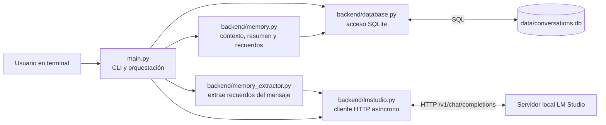
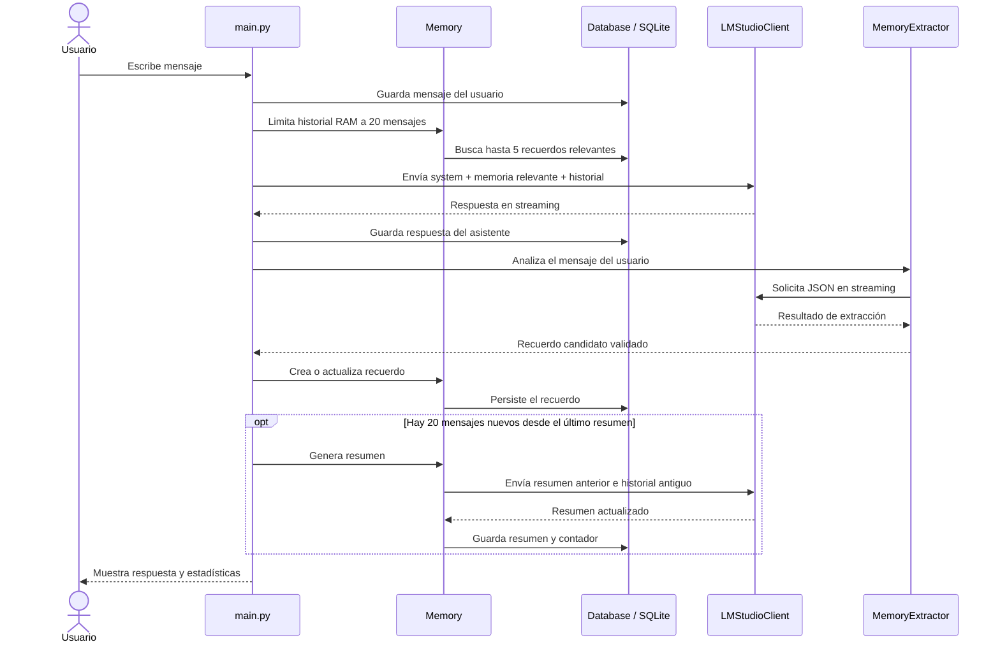

# Arquitectura del proyecto Local AI

## Resumen

Local AI es un asistente de consola en Python que conversa con un servidor local de LM Studio mediante su API compatible con OpenAI. Guarda conversaciones, mensajes, resúmenes y recuerdos permanentes en SQLite. La aplicación actual se inicia desde `main.py` y no presenta una interfaz gráfica ni endpoints web en el código revisado.

## Diagrama de componentes

## Flujo de un mensaje

## Responsabilidades por archivo

| Archivo | Responsabilidad |
| --- | --- |
| `main.py` | Punto de entrada. Mantiene el bucle de consola, procesa comandos, coordina SQLite, memoria y LM Studio, y muestra respuestas/estadísticas. |
| `backend/lmstudio.py` | Cliente asíncrono `httpx` para listar modelos, hacer chat normal y recibir streaming SSE. Configura host, puerto y modelo desde `.env` y conserva el uso reportado por la última llamada. |
| `backend/database.py` | Crea/migra el esquema y encapsula operaciones SQLite para conversaciones, mensajes, resúmenes y recuerdos permanentes. |
| `backend/memory.py` | Construye el contexto de conversación, limita y valida el historial, genera resúmenes, administra recuerdos y busca recuerdos relevantes por coincidencia de palabras. |
| `backend/memory_extractor.py` | Pide al modelo que clasifique un mensaje de usuario y devuelva un recuerdo en JSON; limpia bloques Markdown y valida los campos básicos. |
| `test_resumen.py` | Prueba manual de la lógica de resumen y de que una corrección reciente (Shippo en lugar de Alfa) prevalezca. No usa un framework de pruebas. |
| `requirements.txt` | Dependencias Python declaradas. |

## Datos persistentes

La base predeterminada es `data/conversations.db` (se crea al iniciar `Database`).

| Tabla | Datos principales |
| --- | --- |
| `conversations` | `id`, `title`, `summary`, `summary_message_count`, `created_at`. |
| `messages` | `id`, `conversation_id`, `role`, `content`, `created_at`. Roles usados por la app: `user` y `assistant`. |
| `memory` | `id`, `category`, `key`, `value`, `importance`, `created_at`, `updated_at`. |

El archivo `.env` y `data/` están excluidos por `.gitignore`; no incluir secretos ni una base de datos real al compartir el proyecto. Hay archivos `.backup` y `*-backup` en el workspace, pero no participan en la ejecución normal descrita aquí.

## Contexto y memoria

- En una conversación abierta, `Memory.cargar_memoria` agrega el resumen persistido al mensaje `system`, carga mensajes `user`/`assistant`, limita el historial y evita roles consecutivos iguales.
- Durante el intercambio, `Memory.limitar_memoria` conserva el system prompt y hasta 20 mensajes de historial en RAM.
- Después de una respuesta correcta, `MemoryExtractor.analizar` procesa el mensaje escrito por el usuario. Las categorías que el prompt propone son `preferencias`, `proyectos`, `configuracion`, `objetivos`, `aprendizaje` e `informacion_personal`; importancia de 1 a 5.
- La extracción solo comprueba estructura/campos e importancia. La categoría no se valida contra una lista permitida en Python.
- `Memory.guardar_memoria_automatica` inserta o actualiza según coincidencia exacta de categoría y clave.
- `Memory.buscar_memorias_relevantes` puntúa coincidencias simples de palabras en categoría, clave y valor, añade importancia y devuelve hasta cinco. No usa embeddings ni búsqueda semántica del modelo.
- Se intenta resumir cuando hay al menos 20 mensajes reales y han entrado 20 desde el contador del último resumen. Se resume el historial anterior a los últimos 20; el nuevo resumen sustituye al anterior.

## Comandos de consola

- `/nueva`: crea una conversación nueva.
- `/listar`: lista conversaciones.
- `/abrir ID`: carga conversación, resumen e historial.
- `/borrar ID`: elimina mensajes y conversación; si era la activa, crea otra.
- `/titulo TEXTO`: cambia el título de la conversación activa.
- `/limpiar`: reinicia solo el contexto en RAM; no borra mensajes guardados.
- `/memorias`: lista recuerdos permanentes.
- `/memoria ID`: muestra un recuerdo.
- `/memoria editar ID`: edita categoría, clave, valor e importancia.
- `/memoria borrar ID`: elimina un recuerdo.
- `/salir`: termina el proceso.

## Configuración y ejecución

Variables leídas por `backend/lmstudio.py`:

| Variable | Predeterminado | Uso |
| --- | --- | --- |
| `LM_STUDIO_HOST` | `127.0.0.1` | Host del servidor LM Studio. |
| `LM_STUDIO_PORT` | `1234` | Puerto del servidor. |
| `LM_STUDIO_MODEL` | `google/gemma-3-4b` | Identificador del modelo. |

LM Studio debe estar ejecutándose y tener un modelo disponible. Para iniciar la app, con el entorno virtual y dependencias instaladas, ejecutar `python3 main.py` desde la raíz del proyecto. Para la prueba manual del resumen: `python3 test_resumen.py` (crea una conversación de prueba en la base predeterminada).

## Límites y puntos útiles para mejoras

- La interfaz actual es síncrona para entrada de consola, aunque las llamadas al modelo son asíncronas.
- El extractor hace una segunda llamada al modelo tras cada respuesta correcta, lo que añade latencia.
- `client.last_usage` se actualiza en cada llamada, incluida la extracción; las estadísticas impresas después de extraer memoria pueden corresponder a esa última llamada y no solo a la respuesta visible.
- El mensaje del usuario se guarda en SQLite antes de llamar al modelo. Si falla la llamada, se retira de RAM, pero el guardado de SQLite no se revierte.
- La búsqueda de recuerdos es léxica y la deduplicación depende de coincidencia exacta de clave/categoría.
- La prueba existente cubre un escenario manual de resumen, no automatiza pruebas del cliente HTTP, comandos, persistencia ni extracción de recuerdos.
- Aunque `requirements.txt` declara FastAPI y Uvicorn, no se encontraron rutas o una aplicación web en los archivos Python revisados.

## Contexto para pedir ayuda a otra IA

Puedes pegar este bloque junto con el diagrama y los archivos relevantes:

> Estoy trabajando en Local AI, un asistente local de consola en Python. `main.py` coordina la aplicación; `backend/lmstudio.py` se comunica por HTTP asíncrono y streaming con LM Studio; `backend/database.py` persiste conversaciones, mensajes, resúmenes y recuerdos en SQLite (`data/conversations.db`); `backend/memory.py` reconstruye contexto, limita el historial a 20 mensajes, genera resúmenes al acumular 20 mensajes nuevos y busca hasta cinco recuerdos por coincidencias de palabras; `backend/memory_extractor.py` extrae recuerdos estructurados del mensaje del usuario mediante el modelo. La configuración de LM Studio usa `LM_STUDIO_HOST`, `LM_STUDIO_PORT` y `LM_STUDIO_MODEL`. La interfaz actual es CLI, no web. Antes de proponer cambios, identifica el archivo/flujo responsable, preserva los datos de SQLite y propone una validación enfocada. Mi mejora concreta es: [describir aquí].